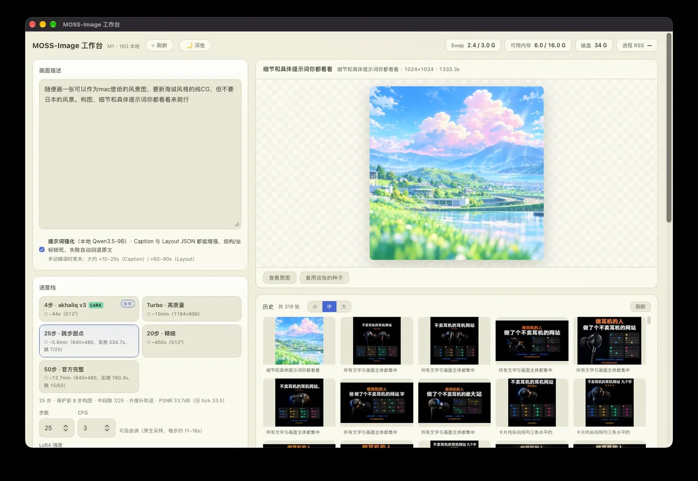
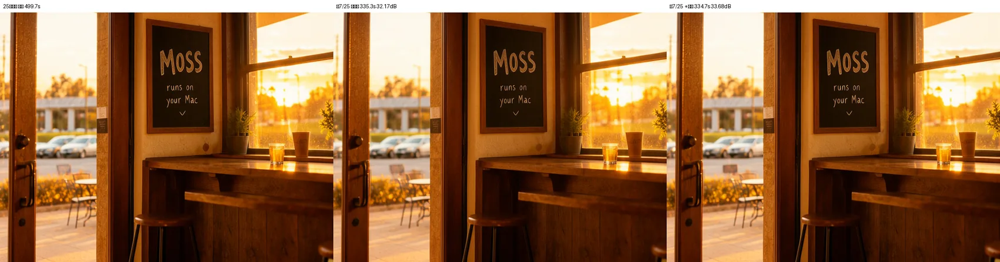
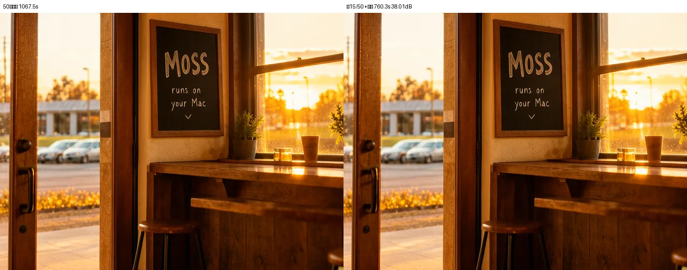

# MOSS-Image Workbench

**A local workbench that actually runs MOSS-Image on a 16 GB Apple Silicon Mac.**
Not "it loads" - "it generates continuously, swap stays near zero, and every speedup is validated with PSNR".

macOS · Apple Silicon · MLX · Apache-2.0 | [中文](README.md)

---

## Why it exists

MOSS-Image is a 5B DiT with a 9B bilingual text encoder. On 16 GB machines the official
pipeline holds both resident (5.6 GB + 5.1 GB), writes 1.4-4.3 GB of swap per image, and
runs every job 2-3x slower - the 50-step tier takes close to 20 minutes.

This repo turns "barely runs" into "usable every day", with four things that are rarely
done together:

### 1. Memory: two-stage processes + streaming DiT

Encode and denoise run in separate processes; the encoder exits after writing embeddings.
The DiT is loaded layer-by-layer via mmap, cutting residency from 5.5 GB to 0.5 GB.
**Result: swap ~= 0 during generation, +1.7% per step, pixel-identical output.**

### 2. Speed: adaptive skipping with an acceptance test

No blind step-cutting. The schedule protects the first 8/16 steps (composition), leaves the
tail untouched, skips mid-trajectory only when adjacent predictions are close, and fills
skipped steps by extrapolating the trajectory. Then it is compared against a no-skip baseline:

| Config | Baseline | With skipping | PSNR |
|---|---|---|---|
| 25 steps (640x480) | 499.7 s | **334.7 s** | 33.68 dB |
| 50 steps (640x480) | 1067.5 s | **760.3 s** | **38.01 dB** |

38 dB is visually lossless - 28.8% saved. The 20-step tier measured 24.3 dB with skipping,
so skipping stays **off** there. Wins where they exist, honesty where they do not.

### 3. Engines: two independent paths

- **MLX 8bit**: upstream mflux 0.24 plus a ~700-line adapter (two-stage, skipping, runtime LoRA,
  time-embedding override).
- **MOSS-MLX**: the pure-MLX moss-image-mlx implementation. ~7-8% faster per forward, and the
  only path for the Turbo tier (15 forwards chasing 50-step quality).

If one engine breaks, the other still draws. Both support stacked character LoRAs.

### 4. Workflow: a tool, not a demo

History browser, parameter snapshots in the lightbox, reproducible seeds, character LoRA
dropdown, four upscalers, lossless PNG recompression, desktop shell (WKWebView, kills
inference on close), crash watchdog.

---

## Comparison

| | Official PyTorch pipeline | Pure MLX CLI | ComfyUI plugin | **This project** |
|---|---|---|---|---|
| Runs on 16 GB | Barely (swap) | Yes | Struggles | **Yes, swap~=0** |
| GUI | No | No | Generic | **Purpose-built** |
| Skip acceleration | No | No | Unvalidated | **PSNR-validated** |
| 50-step at 640x480 | 20 min+ | - | Not quantified | **12.7 min** |
| Upscale / history / snapshots | No | No | Node graphs | **Built in** |

---

## Quick start

    git clone https://github.com/Gladess1102/moss-image-workbench.git
    cd moss-image-workbench
    ./install.sh --with-msmlx
    .venv-mflux/bin/python scripts/doctor.py
    ./run.sh                # http://127.0.0.1:7860

- Downloads the compact tier (~8 GB) by default; use --tier 8bit on 24 GB+ machines.
- The 4-step distilled LoRA (akhaliq v3) is optional: models/akhaliq/akk_4step_lora.safetensors.
  Without it the default tier falls back to 20 steps.
- macOS + Apple Silicon only (MLX/Metal constraint).

## Tiers

| Tier | Forwards | 512x512 | Notes |
|---|---|---|---|
| 4-step | 4 | ~44 s | drafting |
| Turbo | 15 | ~10 min @1184x896 | 50-step quality, needs MOSS-MLX |
| 20-step | 40 | ~445 s | native, no skipping |
| 25-step | ~36 | 334.7 s @640x480 | PSNR 33.7 dB |
| 50-step | ~70 | 760.3 s @640x480 | PSNR 38.0 dB |

## Docs

- [docs/ARCHITECTURE.md](docs/ARCHITECTURE.md)
- [docs/BENCHMARKS.md](docs/BENCHMARKS.md)
- [docs/TROUBLESHOOTING.md](docs/TROUBLESHOOTING.md)

## Known limits

- 16 GB is the floor, not comfort: 12.7 min for a 50-step image is a memory budget, not a bug.
- Small Chinese text inside images still smears - a MOSS model limitation, not quantization.
- Upscale / prompt-enhance weights are not shipped; everything else works without them.
- No model weights are included in this repository.

## License

Code Apache-2.0. Weights from OpenMOSS / VisualInference / nynxz; mflux is MIT;
moss-image-mlx is Apache-2.0. See NOTICE.

All numbers were measured on an M1 / 16 GB; methodology is in BENCHMARKS - bring your machine and prove us wrong.
