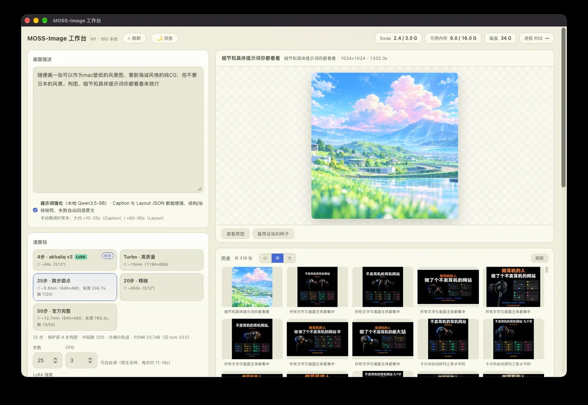

# MOSS-Image Workbench

**16 GB Apple Silicon Mac 上真正跑得动的 MOSS-Image 本地工作台。**
不是「能加载」，是「连续出图、swap 近零、每一步加速都有 PSNR 验收」。

macOS · Apple Silicon · MLX · Apache-2.0 ｜ [English](README.en.md)

---

## 为什么需要它

MOSS-Image 是 5B DiT + 9B 文本编码器的双语生图模型。官方管线在 16 GB Mac 上
会把两个模型同时塞进内存（5.6 GB + 5.1 GB），每出一张图就写 1.4–4.3 GB swap，
任务慢 2–3 倍，五十步档接近 20 分钟。

这个仓库把那套「勉强能跑」变成「能当工具用」，四件事做到了别人没同时做到的：

### 1. 内存：两阶段分进程 + DiT 流式加载

编码和去噪拆成两个进程，前者写完 embedding 就退出；DiT 按层 mmap，常驻从 5.5 GB 降到 0.5 GB。
**效果：生成期 swap ≈ 0，单步只慢 1.7%，输出逐像素一致。**

### 2. 速度：带验收标准的自适应跳步

不是拍脑袋砍步数。自适应判据保护前 8/16 步构图区、尾部收手、中段按预测余弦跳步、
被跳的步用轨迹外推补齐，然后和「不跳基线」对比 PSNR：

| 配置 | 不跳基线 | 跳步后 | PSNR |
|---|---|---|---|
| 25 步（640×480） | 499.7 s | **334.7 s** | 33.68 dB |
| 50 步（640×480） | 1067.5 s | **760.3 s** | **38.01 dB** |

38 dB 属于肉眼无损区间，省 28.8%。20 步档测出来只有 24.3 dB，所以**不开跳步**——
该省的省，不该省的承认省不了。

### 3. 引擎：两条路互为备份

- **MLX 8bit**：官方 mflux 0.24 + 700 行适配层（两阶段、跳步、LoRA 运行时加载、时间嵌入覆盖）。
- **MOSS-MLX**：纯 MLX 的 moss-image-mlx，单前向快 7–8%，Turbo 档（15 次前向追 50 步质量）只能走它。

一个引擎出问题，另一个还能出图；两个都支持角色 LoRA 叠加。

### 4. 工作流：不是 demo，是每天能用的台子

出图历史、灯箱参数快照、随机种子可复现、角色 LoRA 下拉、四路超分、PNG 无损压缩、
桌面壳（WKWebView，关窗即清理推理进程）、崩溃看护。

---

## 对比

| | 官方 PyTorch 管线 | 纯 MLX CLI | ComfyUI 插件 | **本项目** |
|---|---|---|---|---|
| 16 GB 可跑 | 勉强（swap 严重） | 可以 | 吃力 | **可以，swap≈0** |
| 图形界面 | 无 | 无 | 有（通用） | **有（专用）** |
| 跳步加速 | 无 | 无 | 无验收 | **有，带 PSNR** |
| 50 步 640×480 | 20 min+ | — | 未量化 | **12.7 min** |
| 超分 / 历史 / 快照 | 无 | 无 | 需拼节点 | **内置** |

---

## 快速开始

    git clone https://github.com/Gladess1102/moss-image-workbench.git
    cd moss-image-workbench
    ./install.sh --with-msmlx
    .venv-mflux/bin/python scripts/doctor.py
    ./run.sh                # http://127.0.0.1:7860

- 默认下载 compact tier（约 8 GB）+ 4 步蒸馏 LoRA（1.2 GB）；24 GB+ 用参数 --tier 8bit
  拉高画质档，--no-4step 可跳过 LoRA（默认档会自动回落到 20 步）。
- 只支持 macOS + Apple Silicon，这是 MLX/Metal 的硬约束。

## 档位一览

| 档 | 前向 | 512² | 说明 |
|---|---|---|---|
| 4 步 · 极速 | 4 | ~44 s | 构图探索、批量草稿 |
| Turbo · 高质量 | 15 | ~10 min @1184×896 | 追 50 步质量，需 MOSS-MLX 引擎 |
| 20 步 · 精细 | 40 | ~445 s | 细节扎实，不开跳步 |
| 25 步 · 甜点 | ~36 | 334.7 s @640×480 | PSNR 33.7 dB |
| 50 步 · 完整 | ~70 | 760.3 s @640×480 | PSNR 38.0 dB |

## 文档

- [docs/ARCHITECTURE.md](docs/ARCHITECTURE.md) —— 两阶段、适配层的 9 个坑、跳步判据、LoRA 键名
- [docs/BENCHMARKS.md](docs/BENCHMARKS.md) —— 全部实测数字与口径
- [docs/TROUBLESHOOTING.md](docs/TROUBLESHOOTING.md) —— 黑图、swap、._ 文件、App Nap

## 已知限制

- 16 GB 是下限不是舒适线：50 步档单张 12.7 分钟是内存预算，不是代码问题。
- 图中中文小字会糊，这是 MOSS 模型本身限制，与量化无关。
- 超分/提示词强化权重不随仓库分发，按各自许可证自备；缺省时其余功能正常。
- 仓库不含任何模型权重。

## 许可与致谢

代码 Apache-2.0；模型来自 OpenMOSS、VisualInference、nynxz；mflux MIT；
moss-image-mlx Apache-2.0。详见 [NOTICE](NOTICE)。

方法论与数值来自本机 M1 / 16GB 的逐项实测，口径写在 BENCHMARKS 里，欢迎拿你的机器打脸。
