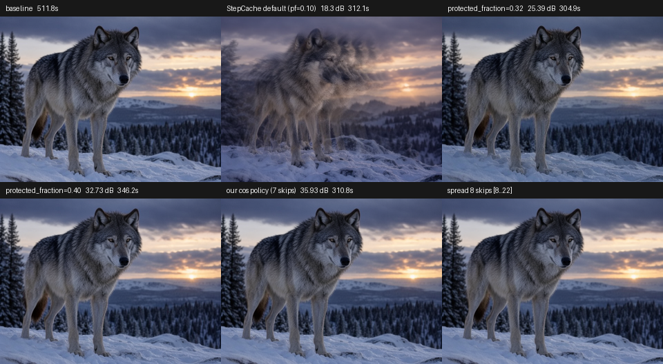

# StepCache `protected_fraction` retest (mflux-community/mflux#950)

Reproduction bundle for the retest posted in
[mflux-community/mflux#950](https://github.com/mflux-community/mflux/issues/950)
after [`protected_fraction` landed in #960](https://github.com/mflux-community/mflux/pull/960).

The question was whether exposing a wider protected window is enough for flow-match
schedules such as MOSS-Image, where the sigma grid is dense at the start, so the
"smallest change" heuristic puts every skip inside the structure region.

Short answer: the window works, the spacing does not.

## Environment

| | |
|---|---|
| Machine | Apple M1, 16 GB unified memory (Mac mini) |
| OS | macOS 27.2 (build 26B123) |
| Python | 3.13.7 |
| MLX | 0.32.4 |
| mflux | `main` @ [`17b47e9`](https://github.com/mflux-community/mflux/commit/17b47e9aa0fd4b65a3ec03b46db31c911e8ac18d) (installed with `--no-deps --target` ahead of 0.24.0) |
| Model | MOSS-Image-SFT, compact 8-bit MLX weights (`mlx_vi_8bit`) |
| Loading | two-stage (text encoder freed before the DiT), streaming DiT layers (mmap) |
| Sampling | Euler on the model's own schedule, 25 steps, 640×480, guidance 3.0, seed 42, uncond skip layer 22 (upstream default) |
| Prompt | one fixed natural-language prompt (wolf on a snowy ridge) — see `retest.py` |

PSNR is measured on the decoded uint8 RGB image against the **uncached** run of the
same seed and prompt. It is a proxy for "did the trajectory survive", not a
perceptual metric.

## Results

| cache config | skipped steps | time | speedup | PSNR |
|---|---|---|---|---|
| no cache | — | 511.8 s | 1.00× | — |
| `ratio=0.3`, `protected_fraction=0.10` (default) | `[2,3,4,5,6,7,8,9]` | 312.1 s | 1.64× | **18.30 dB** |
| `ratio=0.3`, `protected_fraction=0.32` | `[8,9,10,11,12,13,14,15]` | 304.9 s | 1.68× | **25.39 dB** |
| `ratio=0.3`, `protected_fraction=0.40` | `[10,11,12,13,14]` (5) | 346.2 s | 1.48× | **32.73 dB** |
| caller-supplied set `[8,10,12,14,16,18,20,22]` | 8, spread | 294.0 s | 1.74× | **35.51 dB** |
| this workbench's online cosine policy | `[8,10,12,14,16,18,20]` (7) | 310.8 s | 1.65× | **35.93 dB** |



Original frames: [baseline](images/baseline.png) ·
[pf=0.10](images/stepcache-pf010.png) ·
[pf=0.32](images/stepcache-pf032.png) ·
[pf=0.40](images/stepcache-pf040.png) ·
[spread 8](images/spread8.png) ·
[adaptive](images/adaptive.png)

## What the numbers say

1. **`protected_fraction` moves the window off the structure region — and that alone
   buys ~7 dB** (18.3 → 25.4 dB at the same 8 skips). The window works as designed.
2. **But the selection is still contiguous.** At pf=0.32 the eight cheapest sigma
   deltas are steps 8–15, so the run gets one eight-step hole. The same number of
   skips spread every other step reaches 35.5 dB *and* is faster (294 s vs 305 s).
   Adjacency, not the count, is what costs the dB.
3. **A larger protected window only helps by skipping fewer steps.** At pf=0.40 the
   eligible window shrinks to 5 steps, hence 32.7 dB at a lower 1.48× speedup — the
   heuristic cannot spend 8 skips well inside a 25-step run.
4. **Relative `|Δσ|/σ` scoring does not change the answer here.** Selecting with
   `signal_fn=lambda s: mx.log(s)` yields the identical sets (`[2..9]` at pf=0.10,
   `[8..15]` at pf=0.32): the relative change is monotone on this schedule too.
   A spacing/stride rule, or accepting a caller-supplied skip set, is what closes
   the last 10 dB.

## Reproduce

```sh
pip install --no-deps --target /tmp/mfluxmain \
    "git+https://github.com/mflux-community/mflux@main"

MOSS_MODEL=/path/to/mlx_vi_8bit \
PYTHONPATH=/tmp/mfluxmain \
python docs/repro/mflux-stepcache-960/retest.py --outdir /tmp/stepcache-retest
```

The script needs this repository (`web/mflux024_adapter.py`) for weight loading, the
mflux build with `protected_fraction`, and ~6 GB of free memory. Expect ~30 minutes
for all six configurations on an M1.

## Caveats

- One prompt, one seed, one resolution: PSNR numbers move by several dB between
  prompts (the original report measured 10.47 dB for the same skip set with different
  weights). The ordering between configurations is what is stable.
- Compact 8-bit weights; full-precision weights may shift the absolute values.
- `results.json` is the raw output of the run that produced the table above.
